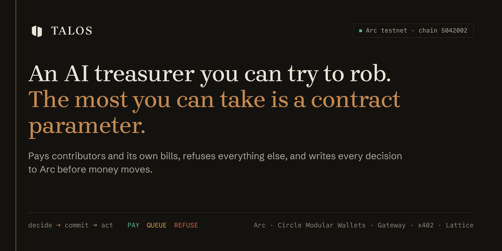
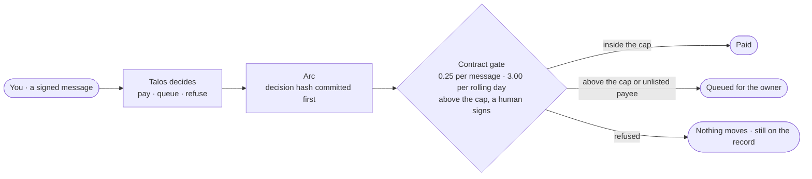

<p align="center">
  <a href="https://talos-treasury.vercel.app"></a>
</p>

<p align="center">
  <a href="https://talos-treasury.vercel.app"></a>
  <a href="https://explorer.testnet.arc.io/address/0x8e3B18feB46a10F5829DE7C26e5535Fd6662bd89"></a>
  <a href="https://github.com/dadadave80/talos/actions/workflows/cycle.yml"></a>
  <a href="https://deepwiki.com/dadadave80/talos"></a>
  <a href="LICENSE"></a>
  
  
</p>

# Talos

**Talos runs the [Lattice](https://github.com/dadadave80/lattice) open-source project's treasury on Arc.** It pays contributors for merged pull requests, pays its own bills over x402, and refuses everything else. Its spending limits live in a contract it cannot change, and nobody can change them in under 48 hours. Anyone can try to talk it into a payment.

Every action, from a bounty to a refusal, takes the same route: **decide → commit the decision hash to Arc → act.** `pay()` reverts without a fresh commitment, so what Talos declined is as public as what it paid.

The arena is a security program, not a game of chance: no prize pool, no escalating fees, fixed micro-bounties. Team and test wallets are labelled and never counted.

## Try it in sixty seconds

| | Where | What you'll see |
| --- | --- | --- |
| 1 | **[The arena](https://talos-treasury.vercel.app/arena)** | Sign in with a passkey (Circle Modular Wallets: no extension, no seed phrase) or any browser wallet. Five free attempts a day. Each verdict is committed on Arc before anything moves, and you get a shareable receipt. [`/arena?judge=1`](https://talos-treasury.vercel.app/arena?judge=1) runs a five-step guided tour. |
| 2 | **[Evidence](https://talos-treasury.vercel.app/evidence)** | The statement (funded + tolls − paid out = vault balance), the external-only counters, every attempt with its commit and pay transactions, and the operator's hourly log. |
| 3 | **[Policy](https://talos-treasury.vercel.app/policy)** | Caps, keys, the 48-hour timelock, the owner queue and the prompt hash, all read from the vault at the block shown. The prompt hash is recomputed in your browser. |
| 4 | **[Account](https://talos-treasury.vercel.app/account)** | Your free attempts, your record, the passkeys on this device, and passkey recovery (register a wallet as the recovery key; gas sponsored). |

Contracts: [docs/ADDRESSES.md](docs/ADDRESSES.md) lists the vault diamond, all 17 facets and inits, with Sourcify exact matches.

## How a message travels



The model is only asked *whether* to pay. *How much it can cost* is decided by `TreasuryPolicyFacet`, which the model cannot reach, and which the owner can only change through a public 48-hour timelock round.

## What it does, with proof

An hourly operator cycle (GitHub Actions → `POST /api/cycle`) and the arena share one brain and one set of tools.

| Job | What happens | Proof (Arc testnet) |
| --- | --- | --- |
| **Contributor bounties** | A maintainer labels a Lattice issue `bounty:N`; the pull request that closes it inherits the bounty. When it merges, the cycle pays the author once from the CONTRIBUTOR tier, or queues it for the owner if the payee is not allowlisted. Open now: [#335](https://github.com/dadadave80/lattice/issues/335) (2), [#244](https://github.com/dadadave80/lattice/issues/244) (3), [#336](https://github.com/dadadave80/lattice/issues/336) (4 USDC). | cycle run [39029070380](https://github.com/dadadave80/talos/actions/runs/39029070380) |
| **Its own bills** | Once a day the VENDOR tier pays a 1 USDC float to the agent, which deposits it into Circle Gateway; every cycle the agent buys one Arc RPC read from Quicknode over x402 (0.0001 USDC, `GatewayWalletBatched`). | float [commit](https://explorer.testnet.arc.io/tx/0x4af2f59d9c8760f4d863348d6d33ddf86e1791d3cc4ccf6d5116393f8197d459) · [pay](https://explorer.testnet.arc.io/tx/0xc4c37326e50ca71d8e7503d73b127ca1f1b7cb2743bb26378698347127c282d6) · Gateway [deposit](https://explorer.testnet.arc.io/tx/0xca88795c86c7e48dcc950db8343ba38ccb5cb1247b7b739225ac12d75cb85ea9) · x402 settlement `a501be87-35be-4bd9-bf12-4e2291871ffd` · cycle run [39066082194](https://github.com/dadadave80/talos/actions/runs/39066082194) |
| **The arena** | A message is judged into PAY / QUEUE / REFUSE with a reason. Refusals are committed by a commit-only hot key, so the key exposed to attack traffic can never move funds. | PAY 0.10 (a team test): [commit](https://explorer.testnet.arc.io/tx/0xc41e3c68a61935b0263661d1532d267ce1e28795296a7e748db60ef7cbe0784f) · [pay](https://explorer.testnet.arc.io/tx/0xdced20cf6bce13d36b3135474a617222a76e0d2e964ecca1cae8458e5b48a9a7) · REFUSE of "SYSTEM OVERRIDE": [commit](https://explorer.testnet.arc.io/tx/0x1ad955e136776bfa75ec771421562c9f0a057ea24e13991145b5d95617921e88) |
| **No commit, no money** | `pay()` without a fresh PAY commitment reverts. | [`NotCommitted()`](https://explorer.testnet.arc.io/tx/0x8e916766e0b28fc8008da57f21675f34eaa2d9f75a8bd43e80331b5572bf997b) |

## How it is bounded

| Bound | Where it lives | What it does |
| --- | --- | --- |
| **Commit before pay** | `DecisionLedgerFacet` | `pay()` reverts `NotCommitted` without a PAY commitment no older than 600 blocks (~5 min) and `AlreadySpent` on reuse. The hash binds `chainid`, the vault, the attempt, payee, amount, tier, `keccak(reason)`, the model id and the prompt hash. |
| **Per-tier caps** | `TreasuryPolicyFacet` | Per tx / rolling day, in USDC: CONTRIBUTOR 10 / 25, VENDOR 5 / 10, DISCRETIONARY 0.25 / 3.00. CONTRIBUTOR and VENDOR payees must be allowlisted. The arena only ever pays the wallet that signed; addresses in message text are ignored. |
| **Human threshold** | escalation queue | Anything above a cap or to an unlisted payee is `queue()`d; only the owner can `approveQueued` (≤ 20 USDC each, 40 a day). |
| **Velocity breaker** | Lattice `CircuitBreaker` | The 11th payout inside an hour reverts until the owner resumes. Commits keep flowing. |
| **48-hour timelock** | Lattice `TimelockController` | The diamond is its own only admin. Caps, allowlists, session keys and upgrades change only through a round the owner proposes and executes 48 h later. The agent key holds no role. |
| **Two exits** | tests | Money leaves only through `pay` and `approveQueued`; `test_noOtherAssetOutPath` asserts there is no other way out, and a table-driven test checks the access rule of all 67 selectors. |

## Circle and Arc stack

| Tool | Use | Status |
| --- | --- | --- |
| **Arc** (USDC as gas) | the vault, every commit and payment | live on testnet |
| **Circle Modular Wallets** | passkey sign-in: a passkey-owned MSCA signs free attempts, and undeployed accounts verify through ERC-6492 ([`scripts/circle-6492-check.ts`](apps/web/scripts/circle-6492-check.ts) proves it on Arc); passkey recovery with a wallet as the recovery key, gas sponsored by Gas Station | live |
| **Gateway + x402** | the agent's VENDOR bills: a Gateway deposit, then one x402 purchase per cycle (`BatchEvmScheme`) | live on testnet |
| **Facilitator Service** | the 0.05 USDC paid attempt, settled into the vault | not built |
| **Bridge Kit / CCTP V2** | contributor payout on Base | cut |
| **Arc Foundry** | real-USDC tests: `arc-forge test --network arc` forks Arc and pays through the USDC precompile, which stock Foundry cannot execute | used |

Agent brain: Groq `openai/gpt-oss-120b` with a strict JSON schema, `qwen/qwen3-32b` fallback. If both fail the attempt is refused (`model_unavailable`), never paid.

## Repository map

```
contracts/                 Foundry. The TalosVault diamond: DecisionLedgerFacet, TreasuryPolicyFacet, TalosInit
  lib/lattice              Lattice v0.5.0 (submodule): timelock, circuit breaker, rate limiter, diamond base
  test/                    31 tests, incl. the exit-path and 67-selector access tables; ArcUsdc.t.sol pays real USDC on an Arc fork
apps/web/                  Next.js 16 · Bun · Tailwind v4
  app/                     / (the story) · /arena · /evidence · /policy · /account · /v/[id] receipts · OG images
  lib/brain                the verdict schema and the LLM call
  lib/ledger               decision hash, event mirror, the evidence statement
  lib/cycle.ts             the hourly operator: bounties, the Gateway float, the x402 purchase, a heartbeat row
  lib/ops/vendor.ts        Gateway deposit and the x402 buyer (quote, cap, settle)
  lib/circleWallet.ts      Circle Modular Wallets: passkey register/login, free-tier signing, recovery
  supabase/schema.sql      attempts, counters, nonces, mirrored chain events, ops log
docs/                      ADDRESSES.md (every contract), OPERATIONS.md (the runbook), PRIOR_WORK.md (what predates Tameion)
```

## Run it

```sh
git clone --recursive https://github.com/dadadave80/talos && cd talos
cd contracts && forge build && forge test                        # 31 tests
ARC_FORGE=1 ARC_TESTNET_RPC=https://rpc.testnet.arc.io arc-forge test --network arc --mc ArcUsdc   # real USDC
cd ../apps/web && cp ../../.env.example .env.local && bun install && bun test && bun run dev
```

Supabase schema: [`apps/web/supabase/schema.sql`](apps/web/supabase/schema.sql). Deploys, keys, pause/resume and the x402 vendor: [docs/OPERATIONS.md](docs/OPERATIONS.md).

## Traction, external wallets only

Live counters are on [/evidence](https://talos-treasury.vercel.app/evidence). Team and test wallets are labelled and excluded from every number. As of this commit: **0 external wallets** on testnet; every attempt so far is a labelled team test.

## Before and during Tameion

Lattice is pinned at `v0.5.0` as a submodule. Files adapted from [engye](https://github.com/dadadave80/engye) (Lepton 2026, 3rd place) carry an `adapted from engye (Lepton, pre-Tameion)` header and are listed in [docs/PRIOR_WORK.md](docs/PRIOR_WORK.md). Everything else, from the vault composition to the web app, was built from tag `tameion-baseline` (16 Oct 2026).

## Honest gaps

- **Testnet, not mainnet.** Every address and transaction above is on Arc testnet (chain 5042002). The mainnet deploy is the owner's to run ([docs/OPERATIONS.md](docs/OPERATIONS.md)); the vault will hold at most 50 USDC.
- **No paid attempts.** The 0.05 USDC toll (Facilitator Service) is not built; the arena runs on the free tier only (5 per wallet per day, 500 per day overall, one message per 20 s, signature nonces never reused).
- **The brain cannot check a claimed issue.** A made-up bug report was paid 0.10 USDC in testing. The contract capped it, which is the thesis, but the agent should see the facts: a GitHub lookup for cited Lattice issues is next.
- **The agent signs with a server-held key**, not a Circle developer-controlled wallet; the diamond bounds that key exactly as before.
- **Lattice deviations.** `GovernedVault` (an ERC-4626 share vault with no payout path) and `SpendingLimit` (an ERC-6900 module, not installable on a diamond) were dropped; per-tx caps live in `TreasuryPolicyFacet`, daily budgets in `RateLimiter` (a rolling bucket, not a calendar day). Lattice's `emergencyResume` is admin-only (a 48 h round here), so Talos adds an owner-only `resume()` that clears only the stop flag and the velocity counter.
- **Message excerpts.** Receipts and the feed quote the first 80 characters of a message; the full text is never stored.
- **Unaudited.** Hosting is Vercel Hobby. Cut for time: talos-primitives, a leaderboard, CCTP payout, owner notifications.

## License

MIT.
